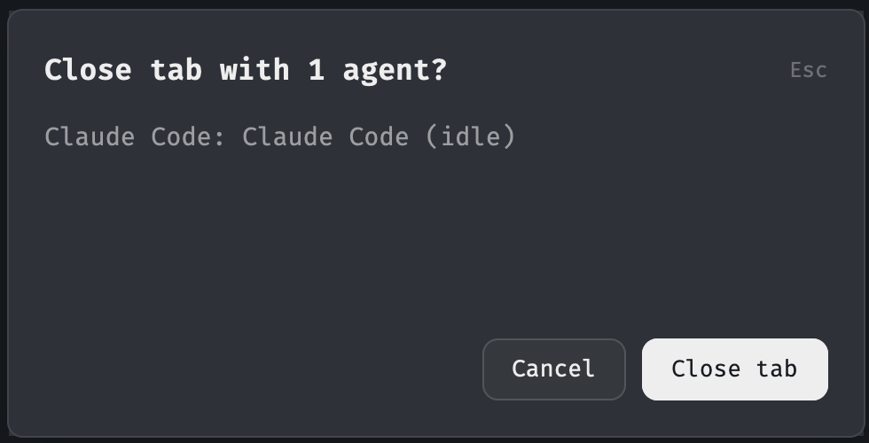

# Herdr Close Guard

Close Guard adds confirmation dialogs to Herdr's `cmd-w` and `cmd-shift-w` shortcuts when the close target contains agents.



## What it does

- `cmd-w` guards the focused tab.
- `cmd-shift-w` guards the focused pane.
- Shell-only targets close without a dialog.
- Targets with agents show each agent's program name, title, and current status.
- Enter or the close button confirms the operation.
- Escape, **Cancel**, or a second invocation of the shortcut cancels it.
- The dialog warns when closing a pane also closes its tab or when closing a tab also closes its space.
- The dialog keeps its original target when focus changes.

Agent statuses include `working`, `blocked`, `idle`, and `done`. A plain shell does not report an agent status, so it does not trigger the guard.

Only the two keyboard shortcuts change. The tab bar close button, right-click menu, `cmd-alt-w`, and `herdr-app do tab.close` retain their normal behavior.

## Requirements

Tested with Herdr app 0.1.13 on macOS.

## Install

Ask your coding agent to install this repository as a Herdr mod:

```text
Install https://github.com/markduan/herdr-close-guard as a Herdr mod.
```

The agent should read [RECIPE.md](RECIPE.md), copy both folders from `mods/`, and merge `keys.json`. It must ask before replacing existing keyboard bindings.

For a manual installation:

1. Copy `mods/close-tab-guard/` and `mods/close-pane-guard/` into `~/.config/herdr-app/mods/`.
2. Merge the following bindings into the `global` section of `~/.config/herdr-app/keys.json`:

   ```json
   {
     "global": {
       "cmd-w": "mod.open:close-tab-guard",
       "cmd-shift-w": "mod.open:close-pane-guard"
     }
   }
   ```

3. Check both mods:

   ```sh
   herdr-app check ~/.config/herdr-app/mods/close-tab-guard
   herdr-app check ~/.config/herdr-app/mods/close-pane-guard
   herdr-app status
   ```

## Development

Run the checks from the repository root:

```sh
herdr-app check mods/close-tab-guard
herdr-app check mods/close-pane-guard
herdr-app status
```

See [RECIPE.md](RECIPE.md) for the implementation details, known limitations, and completion checks.

## License

Licensed under the [Apache License 2.0](LICENSE).
