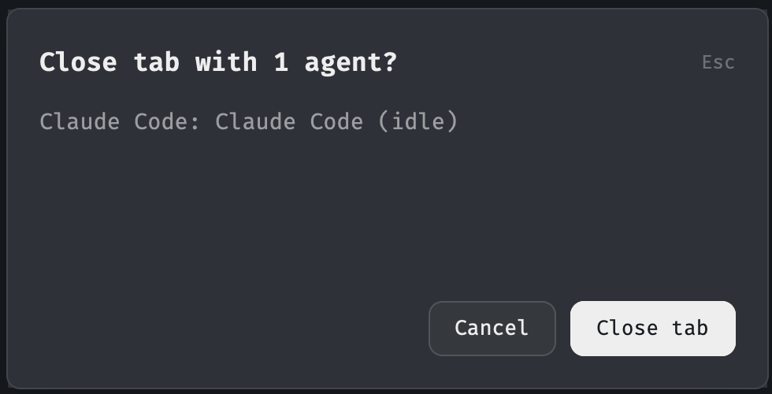

# Close Guard

Close Guard adds confirmation dialogs to Herdr's `cmd-w` and `cmd-shift-w` shortcuts when the close target contains agents. Shell-only targets close without these dialogs.

## What you see

Each guard opens a 440 by 220 pixel dialog when its target contains one or more agents. The dialog uses the active Herdr theme. Its background is `popover`, its main text is `foreground`, and its agent list is `muted`.

An 18 pixel padding and 12 pixel gaps separate the dialog regions. The header shows `Close tab with N agents?` or `Close pane with N agents?` in 15 pixel semibold text. An 11 pixel `Esc` hint appears on the right.

The center lists every agent as `<program name>: <title> (<status>)`. The list uses 13 pixel text and scrolls vertically when necessary. A warning appears below the list when closing the target also closes its tab or space.

The footer contains 32 pixel high `Cancel` and `Close tab` or `Close pane` buttons. The buttons have 8 pixel rounded corners and 14 pixel horizontal padding. A pointer hover reduces button opacity to 88 percent.

No dialog appears for a target without agents. Herdr can still show its own confirmation when the last tab closes a space.

## How it behaves

- `cmd-w` examines the focused tab. `cmd-shift-w` examines the focused pane.
- Agents with any reported status open the dialog. These statuses include `working`, `blocked`, `idle`, and `done`.
- The agent list reads the current status each time the dialog renders.
- Enter and the close button close the captured target. Escape, `Cancel`, and a second invocation of the same shortcut close only the dialog.
- The dialog captures the space, tab, and pane identifiers when it opens. A later focus change does not change its target.
- A shell-only tab or pane closes immediately. A plain shell does not report agent status over OSC 7501.
- Closing the last tab also closes its space. The tab dialog warns about this case.
- Closing the only pane also closes its tab. The pane dialog warns about this case and warns when the tab is also the last tab in its space.
- A focused layout terminal block has no pane identifier. The pane guard does nothing there.
- The close button on the tab bar, the right-click menu, `cmd-alt-w`, and `herdr-app do tab.close` retain their normal behavior.

## Built from

The package contains two independent mods and one `keys.json` file:

- `mods/close-tab-guard/main.js` defines `CloseTabGuard` as a `View`.
- `mods/close-pane-guard/main.js` defines `ClosePaneGuard` as a `View`.
- Both `mod.json` files use `place: none` and a dialog overlay of 440 by 220 pixels.
- `keys.json` binds `cmd-w` to `mod.open:close-tab-guard` and `cmd-shift-w` to `mod.open:close-pane-guard` in the `global` section.

Both mods use `View` and `div` from `gpui-kit`. They use `v_flex` and `h_flex` from `gpui-base`. They use `agents`, `spaces`, `focused`, `run`, `props`, `closeOverlay`, and `theme` from `herdr`.

The tab guard calls `tab.close` with the captured tab identifier. The confirmation path sets `confirmed: true`. The no-agent path omits `confirmed` so Herdr retains its own last-tab confirmation.

The pane guard calls `pane.close` with the captured pane identifier when the tab has multiple panes. It calls `tab.close` instead when the tab has one pane. Its no-agent and confirmation paths follow the same `confirmed` rule as the tab guard.

The mods use no shipped mods, external programs, network requests, external files, or image assets.

## Watch out

1. Do not name a `View` method `close`. Herdr calls `View.close(cx)` when it tears down a copy. A dialog method with that name can close the target during cancellation because `cx` is truthy. Use `closeTarget` for the pane guard's shared close logic.
2. `pane.close` on the only pane closes the whole tab without a prompt. Route that case through `tab.close`.
3. `herdr-app check` runs a mod with `props()` and `focused()` equal to null. Guard access to both values. Initialization must do nothing in this environment.
4. `herdr-app shot` returned a stale frame during the original build. Inspect the screenshot before using it as `preview.png`.
5. Use `mod.open:<name>` for the key actions. A `<mod>.<command>` action reaches only mods shown in the layout.
6. `mod.open` accepts no props. Keep the tab and pane implementations in separate mod folders. Their dialog code is duplicated on purpose.
7. Do not commit `jsconfig.json`, `gpui-kit.d.ts`, or `herdr.d.ts`. Herdr generates these files in each mod folder.

## Done when

- `herdr-app check mods/close-tab-guard` and `herdr-app check mods/close-pane-guard` pass.
- `herdr-app status` reports no mod errors.
- `cmd-w` closes a shell-only tab immediately and opens the tab dialog for an agent tab.
- `cmd-shift-w` closes a shell-only pane immediately and opens the pane dialog for an agent pane.
- The agent list shows the program name, title, and current status for each agent.
- Enter and the close button close the captured target. Escape, `Cancel`, and a second invocation keep the target open.
- The tab dialog warns when its tab is the last tab in a space.
- The pane dialog warns when its pane is the only pane. It also warns when that pane belongs to the last tab in a space.
- The close operations use the captured target after focus changes.
- `preview.png` shows the rendered dialog.
